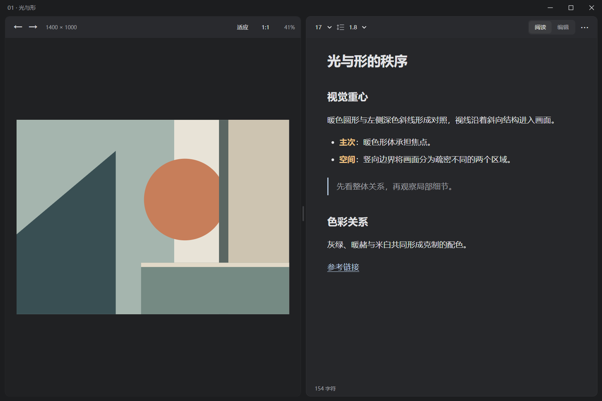

# Eagle 视觉笔记

在 Eagle 中对照图片阅读和编辑 Markdown，直接使用素材的原生注释。



## 安装

需要 **Eagle 4.0 Build 12 或更新版本**。

1. 从 [Releases](https://github.com/Ador-able/eagle-visual-notes/releases/latest) 下载 `.eagleplugin` 文件。
2. 双击安装包，在 Eagle 中确认安装；也可以在插件面板中选择「安装插件」。
3. 选中一张图片，在右侧「视觉笔记」点击「展开」，或按 `P` 打开插件面板，运行「视觉笔记」。

更新时安装同名插件包即可。注释保存在 Eagle 素材库中，卸载插件不会删除注释。

## 使用

左侧用滚轮缩放、拖动平移，双击图片或点击「适应」重置视图；「1:1」显示当前图像的原始像素比例。拖动中间分隔线调整双栏比例。窗口上沿可以拖动，右上角提供最小化、最大化与关闭按钮，`F11` 切换全屏。

右侧在「阅读」和「编辑」之间切换。字号和行距直接在工具栏调整，阅读设置、分栏比例和窗口位置会保留。阅读模式将加粗文字显示为暖金色，编辑模式使用 Markdown 源码与格式工具栏。

编辑内容自动写入 **Eagle 原生注释**。在原生注释区域修改内容后，插件也会读取更新。多个窗口同时编辑时，以最后完成的保存为准。Eagle 原生注释框仍显示 Markdown 源码；插件负责渲染。

「更多」菜单提供当前注释的 Markdown 导出、本库图片注释备份和恢复。恢复按图片 ID 匹配，只补充空白注释，保留已有内容。备份文件不包含图片文件。点击菜单外部或按 `Esc` 收起菜单。

## 快捷键

格式快捷键在编辑器获得焦点时生效。选中文字后应用格式；加粗、斜体、删除线和行内代码可再次按下取消。

| 操作 | Windows | macOS |
| --- | --- | --- |
| 加粗 | Ctrl+B | Cmd+B |
| 斜体 | Ctrl+I | Cmd+I |
| 插入链接 | Ctrl+K | Cmd+K |
| 行内代码 | Ctrl+反引号 | Cmd+反引号 |
| 删除线 | Ctrl+Shift+X | Cmd+Shift+X |
| 标题 1～6 | Ctrl+Alt+1～6 | Cmd+Option+1～6 |
| 正文 | Ctrl+Alt+0 | Cmd+Option+0 |
| 无序列表 | Ctrl+Shift+8 | Cmd+Shift+8 |
| 有序列表 | Ctrl+Shift+7 | Cmd+Shift+7 |
| 引用 | Ctrl+Shift+. | Cmd+Shift+. |
| 缩进 / 取消缩进 | Tab / Shift+Tab | Tab / Shift+Tab |
| 撤销 / 重做 | Ctrl+Z / Ctrl+Shift+Z | Cmd+Z / Cmd+Shift+Z |
| 查找 | Ctrl+F | Cmd+F |
| 立即保存 | Ctrl+S | Cmd+S |
| 阅读 / 编辑 | Ctrl+E | Cmd+E |
| 上一张 / 下一张 | Alt+← / Alt+→ | Option+← / Option+→ |
| 全屏 | F11 | F11 |

在列表、引用中按 Enter 继续当前结构；在空列表项按 Enter 退出。macOS 快捷键按 CodeMirror 的平台映射实现，实机验证范围见[验证说明](docs/验证说明.md)。

## 数据与异常

注释随 Eagle 素材库迁移。插件本地只保存界面设置和工作台打开信号，不另存笔记或草稿。导出和备份仅在主动操作时写入指定位置。

保存失败会显示错误，并暂停图片切换，编辑内容留在当前窗口。修复磁盘连接或切回原素材库后点击「重试保存」；也可从「更多」导出当前文本。正常关闭工作台前会等待保存，强制退出进程、断电或磁盘故障期间尚未保存的内容可能丢失。

## 使用限制

- **面板位置**：可拖动 Eagle 自带的「视觉笔记」标题行，在标签、文件夹、基本信息等区域之间排序。文件名、原生注释和链接是 Eagle 的固定区域，插件无法移到原生注释上方。
- **选图同步**：官方 API 没有选图变化事件。工作台每轮操作完成后间隔 650 ms 查询，Inspector 间隔 900 ms 查询；实际延迟还包括 Eagle 响应和图片解码时间。
- **上一张 / 下一张**：按当前选中文件夹内的图片名称排序；没有选中文件夹时使用整个素材库。官方 API 未提供主界面筛选和排序后的完整列表，因此顺序可能与主界面不同。
- **图片格式**：浏览器支持的图片读取原文件；PSD、RAW、HEIC 等格式使用 Eagle 预览图，`1:1` 对应该预览图的像素。原文件不能解码时也尝试 Eagle 预览图。
- **Markdown**：支持常见段落语法、表格和删除线。原始 HTML 不执行；链接通过系统浏览器打开。远程图片按 Markdown 中的地址加载，离线时可能不可见。

## 从源码构建

使用 Node.js 22 或更新版本：

```sh
npm ci
npm run package
```

构建目录为 `dist/`，安装包和 SHA-256 校验文件位于 `release/`。开发时可在 Eagle 的插件面板中选择开发者选项，载入 `dist/`。

```sh
npm run check
npm run build
npm run verify
```

`verify` 运行 Electron 集成验收，使用临时素材库夹具，不连接个人 Eagle 素材库。截图和结果保存在 `artifacts/verification/`。运行时依赖随包分发，安装后不需要 Node.js。

模块关系、官方 API 依据和失败处理见[技术说明](docs/技术说明.md)。随包第三方依赖的许可原文见构建产物中的 `第三方许可.txt`。
