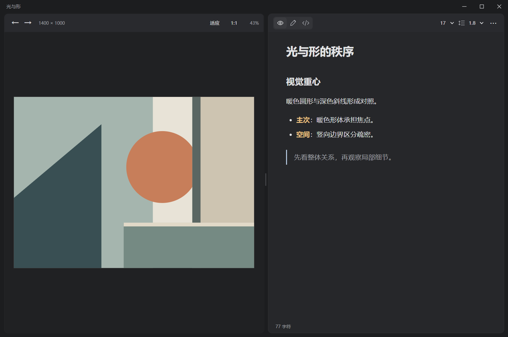
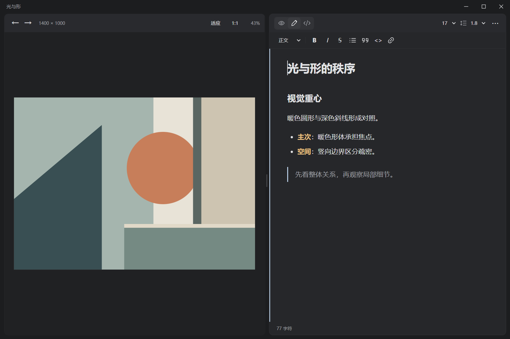

# Eagle 视觉笔记

在 Eagle 中对照图片或视频阅读和编辑 Markdown，直接使用素材的原生注释。



## 安装

需要 **Eagle 4.0 Build 12 或更新版本**。

1. 从 [Releases](https://github.com/Ador-able/eagle-visual-notes/releases/latest) 下载 `.eagleplugin` 文件。
2. 双击安装包，在 Eagle 中确认安装；也可以在插件面板中选择「安装插件」。
3. 首次使用，点击 Eagle 顶部拼图按钮，在「视觉笔记」右侧点击图钉，将它固定到顶部工具栏。
4. 选中图片或视频后，单击顶部的视觉笔记图标，即可打开双栏工作台。

更新时安装同名插件包即可。注释保存在 Eagle 素材库中，卸载插件不会删除注释。

## 使用

左侧显示当前素材。图片按住 Ctrl 并滚动鼠标滚轮，以鼠标所指位置为锚点缩放；拖动图片可平移，双击图片或点击「适应」重置视图。「1:1」显示当前图像的原始像素比例。视频使用播放器底部控件播放、暂停、拖动进度和调节音量，默认暂停；切换素材、隐藏或最小化工作台时暂停播放。

工具栏中的圆形色块读取 Eagle 提取的配色，悬停显示 HEX 色值和占比。点击色块打开色盘，外圈调整色相，内区调整饱和度和亮度；下方显示 HSB、RGB 与 HEX，可用滑块微调并复制色值。色盘调整只用于观察和取色，不改写素材配色。没有配色数据时隐藏色板，窄分栏中自动换行。

拖动中间分隔线调整双栏比例。窗口上沿可以拖动，右上角提供最小化、最大化与关闭按钮，`F11` 切换工作台全屏；视频控件中的全屏按钮只放大视频。

右侧用眼睛、编辑笔、代码括号三个图标切换模式，悬停显示名称：

- **只读**：阅读排版后的笔记，不修改正文。
- **渲染编辑**：直接在标题、段落、列表等排版结果中输入，使用格式按钮或快捷键调整文字。
- **源码编辑**：使用 Markdown 源码，适合精确调整标记或查找文本。

字号、行距、模式、分栏比例和窗口位置会保留。只读与渲染编辑共用字体、间距和暖金色加粗。仅切换模式不会改写注释；在渲染模式实际编辑后，Markdown 的空行、列表符号等写法由编辑器统一整理。跨编辑器修改内容后，目标编辑器会重建撤销历史；同一种编辑模式内可以正常撤销。



编辑内容自动写入 **Eagle 原生注释**。在原生注释区域修改内容后，插件也会读取更新。多个窗口同时编辑时，以最后完成的保存为准。Eagle 原生注释框仍显示 Markdown 源码；插件负责渲染。

多选图片后点击同一个分析入口，即可打开组分析。以后选中组内任意一张再次打开，会显示整组缩略图和共同分析；点击缩略图或前后按钮只切换左侧素材，右侧正文和编辑状态保持不变。仅在主窗口调整多选，不会自动建立新组。

首次打开时，全部为空、正文相同或只有一张有内容，直接沿用；存在不同正文时，先选择并预览要保留的内容，点击「采用并同步到整组」后替换其余成员注释。已经属于不同组的素材不能直接混合打开，需先移出原组。

每个成员都保存完整正文，注释末尾附带插件维护的关联协议。三种笔记模式及 Markdown 导出隐藏协议，注释备份保留协议。删除素材会静默更新其余成员关联；右键缩略图选择「移出组并清空注释」，会清空该素材的全部注释。只剩一张时去掉协议，保留分析正文。

笔记可用 `` 引用当前素材库中的图片。只读和渲染编辑模式会显示图片；素材被删除或不可读取时显示提示。移动素材库时需一并保留配图素材及其 ID；导出的 Markdown 在其他编辑器中不能直接显示这类引用。

「更多」菜单提供当前注释的 Markdown 导出、本库图片与视频注释备份和恢复。恢复按素材 ID 匹配，只补充空白注释，保留已有内容。备份文件不包含媒体文件，配图需随素材库一同备份。保存尚未完成时仍可导出当前笔记。点击菜单外部或按 `Esc` 收起菜单。

## 快捷键

格式快捷键在编辑器获得焦点时生效。选中文字后应用格式；加粗、斜体、删除线和行内代码可再次按下取消。

| 操作 | Windows | macOS |
| --- | --- | --- |
| 加粗 | Ctrl+B | Cmd+B |
| 斜体 | Ctrl+I | Cmd+I |
| 插入链接 | Ctrl+K | Cmd+K |
| 行内代码 | Ctrl+反引号 | Cmd+反引号 |
| 删除线 | Ctrl+Shift+X | Cmd+Shift+X |
| 标题 1～6 | Ctrl+Alt+1～6 | Cmd+Option+1～6 |
| 正文 | Ctrl+Alt+0 | Cmd+Option+0 |
| 无序列表 | Ctrl+Shift+8 | Cmd+Shift+8 |
| 有序列表 | Ctrl+Shift+7 | Cmd+Shift+7 |
| 引用 | Ctrl+Shift+. | Cmd+Shift+. |
| 缩进 / 取消缩进 | Tab / Shift+Tab | Tab / Shift+Tab |
| 撤销 / 重做 | Ctrl+Z / Ctrl+Shift+Z | Cmd+Z / Cmd+Shift+Z |
| 查找（源码编辑） | Ctrl+F | Cmd+F |
| 立即保存 | Ctrl+S | Cmd+S |
| 只读 / 渲染编辑 | Ctrl+E | Cmd+E |
| 上一个 / 下一个素材 | Alt+← / Alt+→ | Option+← / Option+→ |
| 全屏 | F11 | F11 |

在列表、引用中按 Enter 继续当前结构；在空列表项按 Enter 退出。渲染编辑中的 Ctrl+K / Cmd+K 打开链接地址输入框；源码编辑直接插入链接语法。渲染编辑支持粘贴 Markdown，Tab / Shift+Tab 用于列表缩进或表格单元格切换。macOS 实机验证范围见[验证说明](docs/验证说明.md)。

## 数据与异常

注释随 Eagle 素材库迁移。插件本地只保存界面设置，不另存笔记或草稿。工作台在点击工具栏图标或插件面板入口时创建，关闭前等待保存并释放窗口。导出和备份仅在主动操作时写入指定位置。

保存失败会显示错误，并暂停素材切换，编辑内容留在当前窗口。修复磁盘连接或切回原素材库后点击「重试保存」；也可从「更多」导出当前文本。正常关闭工作台前会等待保存，强制退出进程、断电或磁盘故障期间尚未保存的内容可能丢失。

组分析逐张保存，全部写入成功才显示「已保存」。部分失败会显示未同步数量，重试时补齐；重新打开若有不同正文，需选择保留哪份。首次建组中断时，应从已写入协议的成员重开，或重新选择原来的全部素材。移出操作中断后，已写入的协议会记录待清空成员，重开可继续完成。正文按成员数重复存储，保存耗时随组大小增加；Eagle 不提供多素材同时提交的事务。

## 使用限制

- **工作台入口**：插件使用独立窗口，Eagle 右侧保留原生注释区域。Eagle 启动时不会创建视觉笔记窗口。
- **选择同步**：官方 API 没有选择变化事件。工作台每轮操作完成后间隔 650 ms 查询；实际延迟还包括 Eagle 响应和媒体加载时间。
- **前后导航**：组内按建立关联时的顺序切换；单图按 Eagle 接口返回的顺序切换当前选中文件夹内的图片与视频，没有选中文件夹时使用整个素材库。接口返回顺序不保证跟随主界面的筛选、排序设置。
- **图片格式**：浏览器支持的图片读取原文件；PSD、RAW、HEIC 等格式使用 Eagle 预览图，`1:1` 对应该预览图的像素。原文件不能解码时也尝试 Eagle 预览图。
- **视频格式**：识别 MP4、MOV、WebM、MKV 等视频素材，能否播放取决于 Eagle 内置浏览器支持的编码。无法播放时仍可读写笔记，并可点击「用系统播放器打开」。插件不转码；播放位置不会跨素材或关闭窗口保留。笔记属于整段视频，不包含时间点标注。
- **Markdown**：支持常见段落语法、表格和删除线。原始 HTML 不执行；链接通过系统浏览器打开。远程图片按 Markdown 中的地址加载，离线时可能不可见。

## 从源码构建

使用 Node.js 22 或更新版本：

```sh
npm ci
npm run package
```

构建目录为 `dist/`，安装包和 SHA-256 校验文件位于 `release/`。开发时可在 Eagle 的插件面板中选择开发者选项，载入 `dist/`。

```sh
npm run check
npm run build
npm run verify
npm run verify:groups
```

`verify` 运行 Electron 集成验收，使用临时素材库夹具，不连接个人 Eagle 素材库。截图和结果保存在 `artifacts/verification/`。运行时依赖随包分发，安装后不需要 Node.js。

推送到 `main` 后，GitHub Actions 会构建并运行集成验收。更新 `manifest.json`、`package.json` 和 `package-lock.json` 中的版本号后推送，验收通过时会自动创建对应的 Release，并附上安装包和 SHA-256 校验文件；已发布的版本不会重复创建。

模块关系、官方 API 依据和失败处理见[技术说明](docs/技术说明.md)。随包第三方依赖的许可原文见构建产物中的 `第三方许可.txt`。
